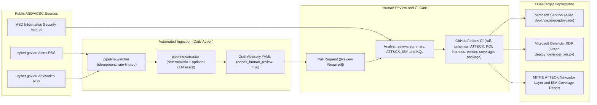
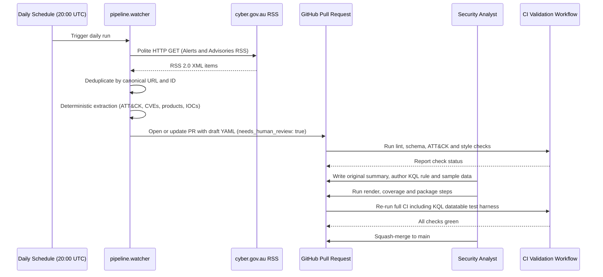
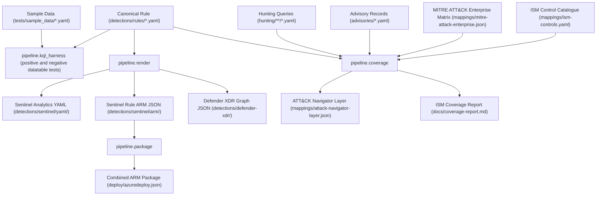

# Architecture and Pipeline Diagrams

This document illustrates how public ASD and ACSC advisories flow from [cyber.gov.au](https://www.cyber.gov.au/alerts-and-advisories) through automated ingestion, human review, CI testing and dual-target deployment into [Microsoft Sentinel](https://learn.microsoft.com/en-us/azure/sentinel/overview) and [Microsoft Defender XDR](https://learn.microsoft.com/en-us/defender-xdr/microsoft-365-defender).

> This is an independent community project. It is not produced, endorsed or supported by ASD, the ACSC or Microsoft.

## 1. End-to-end advisory to deployed rule pipeline

## 2. Advisory watch, review and merge sequence

## 3. Canonical rule to dual-target packaging and coverage flow

